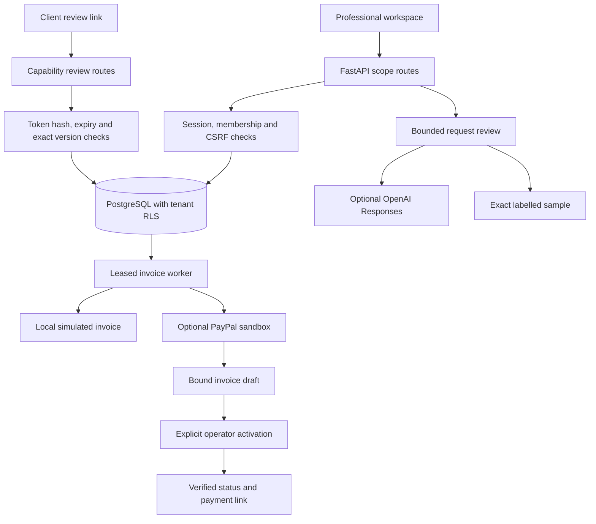

# Scope & Pay architecture

This describes the local working implementation. Real-provider acceptance is a
separate gate. The prior payment-console architecture remains in
[ARCHITECTURE.md](ARCHITECTURE.md).

## Ownership and authority

`backend/app/scope/routes.py` owns domain transitions. PostgreSQL transactions
serialize changes through the project record before proposal/share/invoice locks.
The model has no tools or authority to change prices, accept a proposal or invoice.
The server validates evidence quotes against preserved project messages.

The browser sends public capability tokens in authorization headers and omits
operator cookies. A global directory contains only token hashes and tenant routing;
all actual content remains behind forced workspace RLS. Expiry, revocation and
exact version/digest checks happen before exposing or changing a proposal. An
immutable displayed snapshot remains with every client decision.

Invoice jobs use persistent leases and completion fencing. Creation and activation
are distinct operations. Interrupted provider writes become unknown, retaining a
known provider reference when available. Read-only reconciliation can establish a
payable or paid result; a stale draft read never authorizes blind resending.
The invoice binds to one accepted proposal and the original provider connection.

The React workspace and public client page share the same build. Legacy console
code loads separately at `/operations`. No external font or image service is
needed. The existing console worker runs invoice jobs alongside payment evidence
and repair jobs; throughput isolation between those job families remains a future
load-test question, not a measured guarantee.

## Diagram tooling

An Archify workflow design candidate is retained locally under
`.archify/workflow-scope-pay-20261015-193000/candidate.json`. Its Windows delivery
receipt failed safe file-link publication, including after an elevated retry.
No successful Archify browser/visual validation is claimed. The diagram above is
the readable design fallback; the application build is verified independently.
